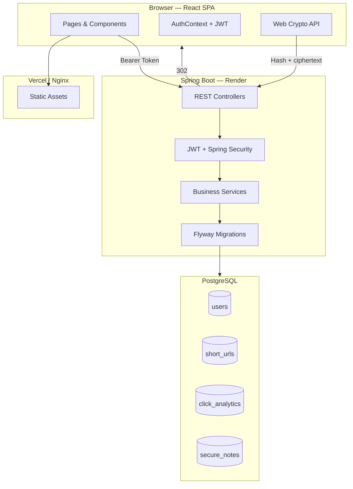
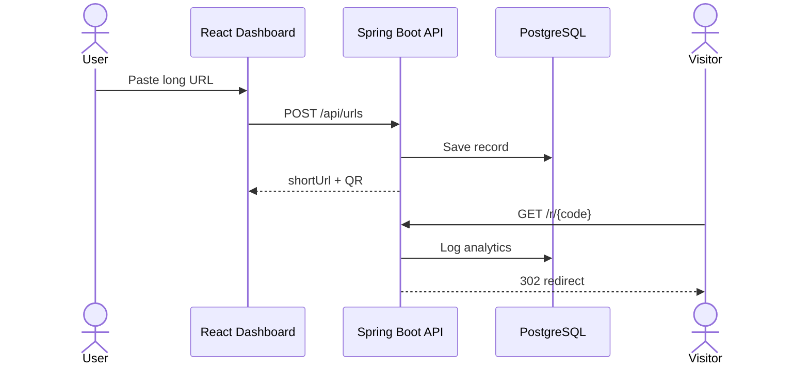
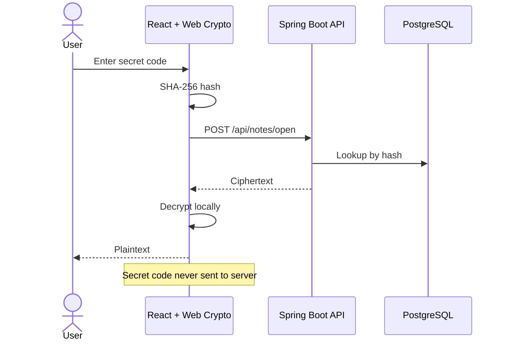
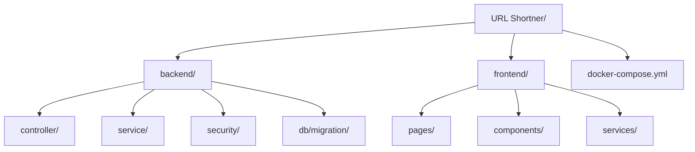
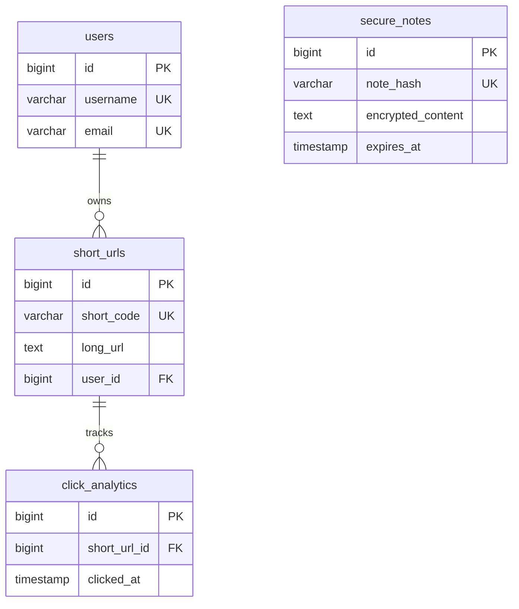

<div align="center">

# SwiftLink

**Production-ready secure sharing platform** — shorten links, share encrypted notes, track analytics.

<p align="center">
  <a href="https://github.com/yourusername/swiftlink">
    
  </a>
</p>

<p align="center">
  
  
  
  
  
  
</p>
<p align="center">
  
  
  
  
</p>

[Overview](#overview) · [Features](#features) · [Architecture](#architecture) · [Getting Started](#getting-started) · [API](#api-overview) · [Deploy](#deployment)

</div>

## Overview

SwiftLink is a full-stack secure sharing platform: an authenticated **URL shortener** with QR codes and click analytics, plus **Secure Notes** with client-side encryption and zero-knowledge storage.

<p align="center">
  
  
  
  
  
</p>

| Product | Description |
|:--------|:------------|
| **URL Shortener** | Custom aliases, QR codes, expiration, enable/disable, public redirects, per-link analytics |
| **Secure Notes** | AES-256-GCM encryption in-browser, anonymous access, configurable expiry, auto-save |

Docs: [`backend/README.md`](backend/README.md) · [`frontend/README.md`](frontend/README.md)

> Screenshots and a walkthrough video will be added after deployment.

## Features

<details>
<summary><strong>URL Shortener</strong></summary>

| Capability | Details |
|:-----------|:--------|
| Short codes | Auto-generated 6-character codes or custom aliases |
| Link control | Titles, expiration, enable/disable toggles |
| QR codes | 300×300 PNG generation |
| Redirects | Public `/r/{code}` with async click telemetry |
| Analytics | Dashboard stats, timelines, browser/OS/device breakdown |

</details>

<details>
<summary><strong>Secure Notes</strong></summary>

| Capability | Details |
|:-----------|:--------|
| Encryption | Client-side AES-256-GCM (PBKDF2 key derivation) |
| Privacy | Zero-knowledge — secret codes never stored on server |
| Access | Anonymous — no account required |
| Expiration | 30 minutes to 30 days, scheduled cleanup |
| Editing | Auto-save while editing existing notes |

</details>

<details>
<summary><strong>Platform</strong></summary>

JWT authentication · BCrypt passwords · dark/light theme · responsive UI · Flyway migrations · Docker Compose · Render + Vercel deploy configs

</details>

## Architecture

**System overview**



<details>
<summary><strong>URL Shortener flow</strong></summary>



</details>

<details>
<summary><strong>Secure Notes flow</strong></summary>



</details>

<details>
<summary><strong>Project structure</strong></summary>



```text
URL Shortner/
├── backend/          # Spring Boot API
├── frontend/         # React + Vite SPA
├── docker-compose.yml
└── render.yaml
```

</details>

## Tech Stack

| Layer | Stack | Role |
|:------|:------|:-----|
| Backend |   | REST API, security, scheduling |
| Frontend |   | SPA, HMR, responsive UI |
| Database |  | Persistent storage |
| Auth |  | Stateless authentication |
| Infra |    | Containers & cloud deploy |
| Data | Flyway · JPA · Recharts · Tailwind CSS 4 | Migrations, ORM, charts, styling |

## Getting Started

**Prerequisites:** Java 17+ · Maven 3.8+ · Node.js 20+ · PostgreSQL 15+ (or Docker)

```bash
git clone https://github.com/yourusername/swiftlink.git
cd swiftlink
docker-compose up --build
```

| Service | URL |
|:--------|:----|
| Frontend | http://localhost |
| Backend API | http://localhost:8080 |
| PostgreSQL | localhost:5432 |

<details>
<summary><strong>Manual setup & environment variables</strong></summary>

```bash
# Backend
cd backend && cp .env.example .env && mvn spring-boot:run

# Frontend (separate terminal)
cd frontend && cp .env.example .env.local && npm install && npm run dev
```

| Variable | Service | Description |
|:---------|:--------|:------------|
| `DATABASE_URL` | Backend | PostgreSQL JDBC string |
| `JWT_SECRET` | Backend | Base64 HMAC key (256+ bits) |
| `FRONTEND_URL` | Backend | CORS origin |
| `APP_URL` | Backend | Public API base for short links |
| `VITE_API_BASE_URL` | Frontend | Backend URL (build-time) |

Templates: [`backend/.env.example`](backend/.env.example) · [`frontend/.env.example`](frontend/.env.example)

</details>

<details>
<summary><strong>Docker commands</strong></summary>

| Container | Image | Port |
|:----------|:------|:-----|
| `swiftlink_db` | postgres:15-alpine | 5432 |
| `swiftlink_backend` | eclipse-temurin:17-jre-alpine | 8080 |
| `swiftlink_frontend` | nginx:alpine | 80 |

```bash
docker-compose up --build -d
docker-compose logs -f backend
docker-compose down
```

</details>

## Deployment

<details>
<summary><strong> Backend on Render</strong></summary>

1. Connect repo → **Web Service** → Docker → `backend/Dockerfile`
2. Set `DATABASE_URL`, `JWT_SECRET`, `FRONTEND_URL`, `APP_URL`
3. Deploy — Flyway runs migrations on startup

Blueprint: [`render.yaml`](render.yaml)

</details>

<details>
<summary><strong> Frontend on Vercel</strong></summary>

1. Import repo → Framework: **Vite** → Root: `frontend`
2. Set `VITE_API_BASE_URL` to your Render backend URL
3. Deploy — SPA routing via [`vercel.json`](frontend/vercel.json)

</details>

## API Overview

<details>
<summary><strong>Authentication <code>/api/auth</code></strong></summary>

| Method | Endpoint | Auth | Description |
|:-------|:---------|:----:|:------------|
| `POST` | `/api/auth/register` | — | Register user |
| `POST` | `/api/auth/login` | — | Login, receive JWT |
| `PUT` | `/api/auth/profile` | JWT | Update profile |

</details>

<details>
<summary><strong>URLs <code>/api/urls</code></strong></summary>

| Method | Endpoint | Auth | Description |
|:-------|:---------|:----:|:------------|
| `POST` | `/api/urls` | JWT | Create short URL |
| `GET` | `/api/urls` | JWT | List URLs |
| `GET` | `/api/urls/{id}` | JWT | Get details |
| `PUT` | `/api/urls/{id}` | JWT | Update URL |
| `PUT` | `/api/urls/{id}/toggle` | JWT | Enable/disable |
| `DELETE` | `/api/urls/{id}` | JWT | Delete URL |
| `GET` | `/api/urls/{id}/qrcode` | JWT | QR PNG |

</details>

<details>
<summary><strong>Analytics <code>/api/analytics</code> · Public <code>/r</code> · Notes <code>/api/notes</code></strong></summary>

| Method | Endpoint | Auth | Description |
|:-------|:---------|:----:|:------------|
| `GET` | `/api/analytics/dashboard` | JWT | Dashboard stats |
| `GET` | `/api/analytics/clicks-by-day` | JWT | Click timeline |
| `GET` | `/api/analytics/top-urls` | JWT | Top 5 URLs |
| `GET` | `/api/analytics/urls/{id}` | JWT | Per-URL analytics |
| `GET` | `/r/{code}` | — | Public redirect |
| `POST` | `/api/notes` | — | Create/update note |
| `POST` | `/api/notes/open` | — | Open note by hash |
| `DELETE` | `/api/notes/{noteHash}` | — | Delete note |

</details>

Full reference: [`backend/README.md`](backend/README.md)

## Database

<details>
<summary><strong>Schema diagram</strong></summary>



| Migration | Description |
|:----------|:------------|
| `V1__init.sql` | Users, short URLs, click analytics |
| `V2__secure_notes.sql` | Initial secure notes |
| `V3__secure_notes_redesign.sql` | Anonymous hash-based notes |

</details>

## Security & Highlights

| Security | Highlights |
|:---------|:-----------|
| BCrypt password hashing | Dual-product: URL shortener + secure notes |
| Stateless JWT (24h) | Zero-knowledge client-side encryption |
| CORS allowlist | Docker + Render + Vercel configs |
| AES-256-GCM secure notes | Real-time click analytics |
| Parameterized JPA queries | Flyway schema versioning |
| React XSS auto-escaping | Clean layered architecture |

## Contributing

Fork → branch → commit → pull request. Test with Docker Compose. Do not commit secrets.

<details>
<summary><strong>Roadmap</strong></summary>

Custom domains · team workspaces · webhooks · GeoIP heatmaps · link passwords · bulk CSV import · OAuth2 · rate limiting · admin dashboard · PWA

</details>

## License

MIT — see [LICENSE](LICENSE).

## Author

**Your Name** · [@yourusername](https://github.com/yourusername) · [LinkedIn](https://linkedin.com/in/yourprofile) · [Portfolio](https://yoursite.com)

---

<div align="center">

**SwiftLink** — Shorten smart. Share secure.

<p align="center">
  
  
  
  
  
</p>

</div>
