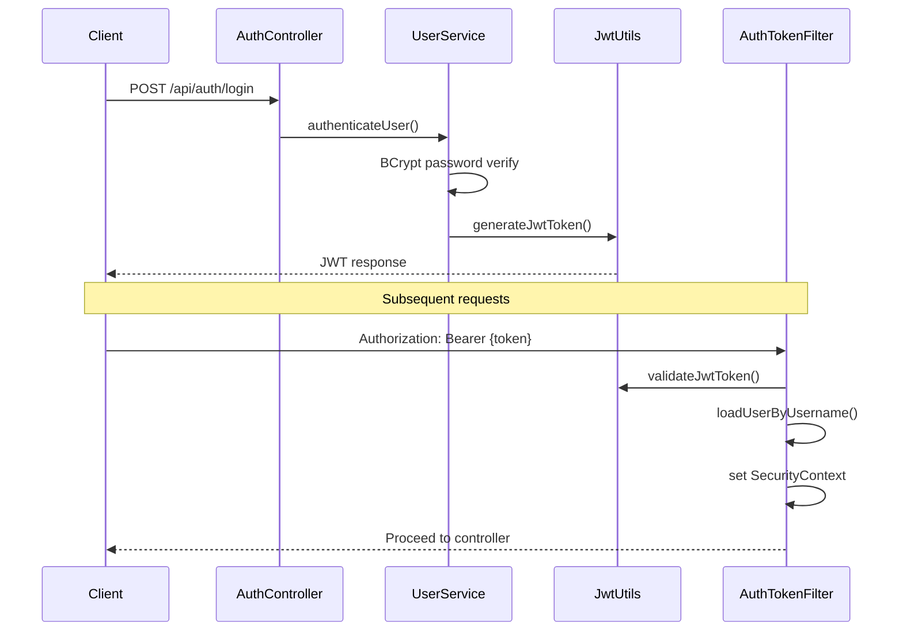

<div align="center">

# SwiftLink Backend

REST API for the SwiftLink secure sharing platform.

[](https://openjdk.org/)
[](https://spring.io/projects/spring-boot)
[](https://www.postgresql.org/)
[](https://jwt.io/)
[](Dockerfile)
[](https://render.com)
[](../LICENSE)

[← Main README](../README.md)

</div>

---

Spring Boot 3.4.3 REST API with Spring Security, JWT authentication, Flyway migrations, and PostgreSQL.

---

## Spring Boot Overview

SwiftLink Backend is a stateless REST API that handles:

- User registration, login, and profile management
- Short URL CRUD with custom aliases and expiration
- Public redirect service with async click telemetry
- Dashboard and per-link analytics aggregation
- Anonymous secure note storage (encrypted ciphertext only)
- QR code PNG generation via Google ZXing

| Component | Package |
|-----------|---------|
| Entry point | `com.urlshortener.UrlShortenerApplication` |
| Controllers | `com.urlshortener.controller` |
| Services | `com.urlshortener.service` |
| Security | `com.urlshortener.security` |
| Entities | `com.urlshortener.entity` |
| Migrations | `src/main/resources/db/migration/` |

---

## Project Structure

```text
backend/
├── Dockerfile
├── pom.xml
├── .env.example
└── src/main/
    ├── java/com/urlshortener/
    │   ├── UrlShortenerApplication.java
    │   ├── config/
    │   │   └── SecurityConfig.java          # CORS, JWT filter chain, public routes
    │   ├── controller/
    │   │   ├── AuthController.java            # /api/auth/*
    │   │   ├── UrlController.java           # /api/urls/*
    │   │   ├── AnalyticsController.java     # /api/analytics/*
    │   │   ├── RedirectController.java      # /r/{code}
    │   │   └── SecureNoteController.java    # /api/notes/*
    │   ├── dto/                               # 17 request/response DTOs
    │   ├── entity/
    │   │   ├── User.java
    │   │   ├── ShortUrl.java
    │   │   ├── ClickAnalytics.java
    │   │   └── SecureNote.java
    │   ├── exception/
    │   │   ├── GlobalExceptionHandler.java
    │   │   ├── BadRequestException.java
    │   │   ├── ResourceNotFoundException.java
    │   │   └── ErrorResponse.java
    │   ├── repository/                        # Spring Data JPA interfaces
    │   ├── security/
    │   │   ├── JwtUtils.java
    │   │   ├── AuthTokenFilter.java
    │   │   ├── AuthEntryPointJwt.java
    │   │   ├── UserDetailsImpl.java
    │   │   └── UserDetailsServiceImpl.java
    │   ├── service/
    │   │   ├── UserService.java
    │   │   ├── ShortUrlService.java
    │   │   ├── AnalyticsService.java
    │   │   ├── SecureNoteService.java
    │   │   └── SecureNoteCleanupService.java  # Hourly expired note cleanup
    │   └── util/
    │       ├── QrCodeGenerator.java
    │       └── NoteExpirationHelper.java
    └── resources/
        ├── application.yml
        └── db/migration/
            ├── V1__init.sql
            ├── V2__secure_notes.sql
            └── V3__secure_notes_redesign.sql
```

---

## REST API Documentation

All authenticated endpoints require:

```http
Authorization: Bearer <jwt_token>
Content-Type: application/json
```

### Authentication

#### Register

```http
POST /api/auth/register
```

```json
{
  "username": "janesmith",
  "email": "jane@example.com",
  "password": "securepassword123"
}
```

**Response:** `200 OK`

```json
{
  "message": "User registered successfully with ID: 1"
}
```

#### Login

```http
POST /api/auth/login
```

```json
{
  "usernameOrEmail": "jane@example.com",
  "password": "securepassword123"
}
```

**Response:** `200 OK`

```json
{
  "token": "eyJhbGciOiJIUzI1NiJ9...",
  "id": 1,
  "username": "janesmith",
  "email": "jane@example.com",
  "role": "ROLE_USER"
}
```

#### Update Profile

```http
PUT /api/auth/profile
```

```json
{
  "username": "newusername",
  "email": "newemail@example.com"
}
```

**Response:** New JWT + updated user info.

---

### URL Management

#### Create Short URL

```http
POST /api/urls
```

```json
{
  "longUrl": "https://example.com/page",
  "customAlias": "my-link",
  "title": "Campaign Link",
  "expiresAt": "2026-12-31T23:59:59Z"
}
```

#### List URLs

```http
GET /api/urls
```

#### Get / Update / Delete

```http
GET    /api/urls/{id}
PUT    /api/urls/{id}
DELETE /api/urls/{id}
PUT    /api/urls/{id}/toggle?enabled=true
GET    /api/urls/{id}/qrcode    → image/png
```

---

### Analytics

```http
GET /api/analytics/dashboard
GET /api/analytics/clicks-by-day?days=7
GET /api/analytics/top-urls
GET /api/analytics/urls/{id}
```

---

### Public Redirect

```http
GET /r/{shortCode}
```

Returns `302 Found` redirect. Logs IP, User-Agent (browser/OS/device), and referrer asynchronously.

---

### Secure Notes (Public)

```http
POST   /api/notes              # Create or upsert by note hash
POST   /api/notes/open         # Retrieve by hash (404 if expired)
DELETE /api/notes/{noteHash}   # Delete by hash
```

---

## Authentication

| Mechanism | Details |
|-----------|---------|
| **Strategy** | Stateless JWT |
| **Password hashing** | BCrypt |
| **Token signing** | HMAC-SHA256 (Base64-decoded secret) |
| **Token lifetime** | 24 hours (configurable) |
| **Session policy** | `STATELESS` — no server-side sessions |

### JWT Claims

| Claim | Value |
|-------|-------|
| `sub` | Username |
| `email` | User email |
| `id` | User ID |
| `exp` | Expiration timestamp |

---

## JWT Flow



### Public Routes (no JWT required)

| Pattern | Purpose |
|---------|---------|
| `/api/auth/**` | Registration and login |
| `/r/**` | Public URL redirects |
| `/api/notes/**` | Secure notes (anonymous) |
| `/error` | Error handling |

---

## Database Design

### Entity Relationship

```
users (1) ──→ (N) short_urls (1) ──→ (N) click_analytics
secure_notes (standalone — no user FK)
```

### Tables

<details>
<summary><strong>users</strong></summary>

| Column | Type | Constraints |
|--------|------|-------------|
| `id` | BIGINT | PK, auto-increment |
| `username` | VARCHAR(50) | UNIQUE, NOT NULL |
| `email` | VARCHAR(100) | UNIQUE, NOT NULL |
| `password` | VARCHAR(255) | NOT NULL (BCrypt) |
| `role` | VARCHAR(20) | DEFAULT `ROLE_USER` |
| `created_at` | TIMESTAMPTZ | NOT NULL |
| `updated_at` | TIMESTAMPTZ | NOT NULL |

</details>

<details>
<summary><strong>short_urls</strong></summary>

| Column | Type | Constraints |
|--------|------|-------------|
| `id` | BIGINT | PK |
| `short_code` | VARCHAR(50) | UNIQUE, NOT NULL |
| `long_url` | TEXT | NOT NULL |
| `custom_alias` | VARCHAR(50) | UNIQUE, nullable |
| `title` | VARCHAR(255) | nullable |
| `expires_at` | TIMESTAMPTZ | nullable |
| `is_enabled` | BOOLEAN | DEFAULT TRUE |
| `click_count` | INTEGER | DEFAULT 0 |
| `user_id` | BIGINT | FK → users, CASCADE |

</details>

<details>
<summary><strong>click_analytics</strong></summary>

| Column | Type | Description |
|--------|------|-------------|
| `short_url_id` | BIGINT | FK → short_urls |
| `clicked_at` | TIMESTAMPTZ | Click timestamp |
| `browser` | VARCHAR(100) | Parsed from User-Agent |
| `operating_system` | VARCHAR(100) | Parsed from User-Agent |
| `device_type` | VARCHAR(50) | Desktop/Mobile/Tablet |
| `ip_address` | VARCHAR(45) | Client IP (X-Forwarded-For aware) |
| `referrer` | VARCHAR(255) | HTTP Referer header |

</details>

<details>
<summary><strong>secure_notes</strong></summary>

| Column | Type | Description |
|--------|------|-------------|
| `note_hash` | VARCHAR(64) | SHA-256 of secret code (lookup key) |
| `encrypted_content` | TEXT | AES-256-GCM ciphertext from client |
| `title` | VARCHAR(255) | Optional display title |
| `expires_at` | TIMESTAMPTZ | Auto-delete after this time |

No user association — fully anonymous.

</details>

---

## Flyway Migrations

| Version | File | Description |
|---------|------|-------------|
| V1 | `V1__init.sql` | Core schema: users, short_urls, click_analytics + indexes |
| V2 | `V2__secure_notes.sql` | Initial secure notes with user association |
| V3 | `V3__secure_notes_redesign.sql` | Redesigned anonymous hash-based notes |

Migrations run automatically on application startup. Hibernate `ddl-auto` is set to `validate` — schema changes must go through Flyway.

---

## Docker

### Build

```bash
docker build -t swiftlink-backend ./backend
```

### Run

```bash
docker run -p 8080:8080 \
  -e DATABASE_URL=jdbc:postgresql://host:5432/urlshortener \
  -e SPRING_DATASOURCE_USERNAME=postgres \
  -e SPRING_DATASOURCE_PASSWORD=postgres \
  -e JWT_SECRET=your-base64-secret \
  -e FRONTEND_URL=http://localhost:5173 \
  -e APP_URL=http://localhost:8080 \
  swiftlink-backend
```

### Docker Compose

From the project root:

```bash
docker-compose up --build backend
```

The backend waits for PostgreSQL health check before starting.

---

## Environment Variables

Copy `.env.example` to `.env` or set in your deployment platform:

| Variable | Required | Default | Description |
|----------|----------|---------|-------------|
| `PORT` | No | `8080` | HTTP server port |
| `DATABASE_URL` | Yes | — | JDBC connection string |
| `SPRING_DATASOURCE_USERNAME` | Yes | — | DB username |
| `SPRING_DATASOURCE_PASSWORD` | Yes | — | DB password |
| `JWT_SECRET` | Yes | — | Base64 HMAC key (256+ bits) |
| `JWT_EXPIRATION_MS` | No | `86400000` | Token TTL in milliseconds |
| `FRONTEND_URL` | Yes | — | CORS allowed origin |
| `APP_URL` | Yes | — | Public API base for short URLs |

**Generate a secure JWT secret:**

```bash
openssl rand -base64 64
```

---

## Build Instructions

### Prerequisites

- Java 17 (JDK)
- Maven 3.8+
- PostgreSQL 15+ (running instance)

### Build JAR

```bash
cd backend
mvn clean package -DskipTests
```

Output: `target/urlshortener-0.0.1-SNAPSHOT.jar`

### Run Tests

```bash
mvn test
```

---

## Run Instructions

### Development

```bash
cd backend
mvn spring-boot:run
```

API available at http://localhost:8080

### Production JAR

```bash
java -jar target/urlshortener-0.0.1-SNAPSHOT.jar
```

### With Environment Variables

```bash
export DATABASE_URL=jdbc:postgresql://localhost:5432/urlshortener
export SPRING_DATASOURCE_USERNAME=postgres
export SPRING_DATASOURCE_PASSWORD=postgres
export JWT_SECRET=$(openssl rand -base64 64)
export FRONTEND_URL=http://localhost:5173
export APP_URL=http://localhost:8080

mvn spring-boot:run
```

---

## Security

| Layer | Implementation |
|-------|---------------|
| Authentication | JWT bearer tokens via `AuthTokenFilter` |
| Authorization | `@PreAuthorize` + ownership checks in services |
| Password storage | BCrypt hashing |
| CORS | Configured in `SecurityConfig` for `FRONTEND_URL` |
| SQL injection | JPA parameterized queries |
| Error responses | JSON via `GlobalExceptionHandler` (no stack traces in prod) |
| Secure notes | Server stores only SHA-256 hash + ciphertext |
| Scheduled cleanup | `@Scheduled` hourly purge of expired notes |

---

## API Endpoint Table

| Method | Endpoint | Auth | Description |
|--------|----------|:----:|-------------|
| `POST` | `/api/auth/register` | — | Register user |
| `POST` | `/api/auth/login` | — | Login, receive JWT |
| `PUT` | `/api/auth/profile` | JWT | Update profile |
| `POST` | `/api/urls` | JWT | Create short URL |
| `GET` | `/api/urls` | JWT | List user URLs |
| `GET` | `/api/urls/{id}` | JWT | Get URL details |
| `PUT` | `/api/urls/{id}` | JWT | Update URL |
| `PUT` | `/api/urls/{id}/toggle` | JWT | Toggle enabled status |
| `DELETE` | `/api/urls/{id}` | JWT | Delete URL |
| `GET` | `/api/urls/{id}/qrcode` | JWT | Download QR PNG |
| `GET` | `/api/analytics/dashboard` | JWT | Dashboard stats |
| `GET` | `/api/analytics/clicks-by-day` | JWT | Click timeline |
| `GET` | `/api/analytics/top-urls` | JWT | Top 5 URLs |
| `GET` | `/api/analytics/urls/{id}` | JWT | URL analytics detail |
| `GET` | `/r/{code}` | — | Public redirect |
| `POST` | `/api/notes` | — | Create/update note |
| `POST` | `/api/notes/open` | — | Open note by hash |
| `DELETE` | `/api/notes/{noteHash}` | — | Delete note |

---

## Error Handling

All errors return a consistent JSON structure via `GlobalExceptionHandler`:

```json
{
  "timestamp": "2026-06-27T10:00:00Z",
  "status": 400,
  "error": "Bad Request",
  "message": "Custom alias already taken",
  "path": "/api/urls"
}
```

| HTTP Status | Exception | When |
|-------------|-----------|------|
| `400` | `BadRequestException` | Invalid input, duplicate alias |
| `401` | `AuthEntryPointJwt` | Missing/invalid JWT |
| `404` | `ResourceNotFoundException` | URL or note not found |
| `500` | Unhandled | Unexpected server error |

---

<div align="center">

[← Back to main README](../README.md)

</div>
