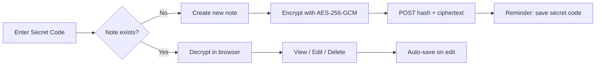
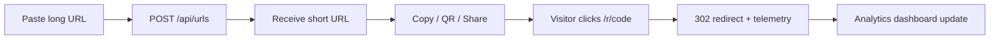

<div align="center">

# SwiftLink Frontend

React SPA for the SwiftLink secure sharing platform.

[](https://react.dev/)
[](https://vitejs.dev/)
[](https://jwt.io/)
[](Dockerfile)
[](https://vercel.com)
[](../LICENSE)

[← Main README](../README.md)

</div>

---

React 19 + Vite 8 single-page application with Tailwind CSS 4, Recharts analytics, and client-side encrypted secure notes.

---

## React Overview

SwiftLink Frontend is a modern SPA featuring:

- JWT-authenticated dashboard for URL management and analytics
- Public secure notes tool with in-browser AES-256 encryption
- Glassmorphism design system with dark/light theme toggle
- Fully responsive layouts for mobile, tablet, and desktop
- Real-time charts powered by Recharts

| Tool | Version |
|------|---------|
| React | 19.2.6 |
| Vite | 8.0.12 |
| React Router | 7.18.0 |
| Tailwind CSS | 4.3.1 |
| Axios | 1.18.0 |
| Recharts | 3.8.1 |

---

## Folder Structure

```text
frontend/
├── Dockerfile                   # Multi-stage: Node build → Nginx serve
├── nginx.conf                   # SPA fallback routing
├── vercel.json                  # Vercel rewrite rules
├── package.json
├── vite.config.js
├── postcss.config.js
├── index.html
├── .env.example
└── src/
    ├── main.jsx                 # App mount, providers, Toaster
    ├── App.jsx                  # Route definitions
    ├── index.css                # Tailwind + design system
    ├── components/
    │   ├── Navbar.jsx           # Sticky header, mobile drawer
    │   ├── Sidebar.jsx        # Dashboard navigation
    │   ├── Footer.jsx
    │   ├── StatCard.jsx         # Dashboard metric cards
    │   ├── UrlCard.jsx          # Mobile URL list item
    │   ├── UrlTable.jsx         # Desktop URL table
    │   ├── CreateUrlModal.jsx   # Create/edit URL dialog
    │   ├── QRCodeModal.jsx      # QR preview & download
    │   ├── AnalyticsChart.jsx   # Recharts wrappers
    │   ├── ConfirmDeleteDialog.jsx
    │   ├── EmptyState.jsx
    │   └── Loader.jsx
    ├── context/
    │   ├── AuthContext.jsx      # JWT session management
    │   └── ThemeContext.jsx     # Dark mode toggle
    ├── layouts/
    │   └── Layout.jsx           # Navbar + Sidebar + Outlet shell
    ├── pages/
    │   ├── LandingPage.jsx
    │   ├── LoginPage.jsx
    │   ├── RegisterPage.jsx
    │   ├── Dashboard.jsx
    │   ├── MyUrlsPage.jsx
    │   ├── UrlDetailsPage.jsx   # Per-link analytics
    │   ├── ProfilePage.jsx      # Account settings
    │   ├── SecureNotesPage.jsx  # Encrypted notes (standalone)
    │   └── NotFoundPage.jsx
    ├── routes/
    │   └── ProtectedRoute.jsx   # Auth guard
    ├── services/
    │   └── api.js               # Axios instance + JWT interceptor
    └── utils/
        ├── noteCrypto.js        # AES-256-GCM + PBKDF2
        └── noteExpiration.js    # Expiry options & formatting
```

---

## Routing

| Path | Page | Layout | Auth |
|------|------|--------|:----:|
| `/` | LandingPage | Standalone | Public |
| `/login` | LoginPage | Standalone | Public |
| `/register` | RegisterPage | Standalone | Public |
| `/secure-notes` | SecureNotesPage | Standalone | Public |
| `/dashboard` | Dashboard | Layout + Sidebar | Required |
| `/urls` | MyUrlsPage | Layout | Required |
| `/urls/:id` | UrlDetailsPage | Layout | Required |
| `/profile` | ProfilePage | Layout | Required |
| `/404` | NotFoundPage | Standalone | Public |
| `*` | → `/404` | — | — |

### Route Guard

`ProtectedRoute` checks `isAuthenticated` from `AuthContext`. Unauthenticated users are redirected to `/login`. A full-page loader displays while auth state initializes.

---

## Components

### Layout Components

| Component | Role |
|-----------|------|
| `Layout` | Dashboard shell with sidebar toggle state |
| `Navbar` | Sticky header, theme toggle, mobile menu drawer |
| `Sidebar` | Fixed desktop nav / slide-in mobile drawer |
| `Footer` | Copyright footer in dashboard layout |

### Feature Components

| Component | Role |
|-----------|------|
| `StatCard` | Animated metric card with color variants |
| `UrlTable` | Desktop table with sort, toggle, actions |
| `UrlCard` | Mobile-optimized URL card layout |
| `CreateUrlModal` | Modal form for create/edit URLs |
| `QRCodeModal` | QR code preview and PNG download |
| `AnalyticsChart` | Timeline, bar, and pie chart wrappers |
| `ConfirmDeleteDialog` | Destructive action confirmation |
| `EmptyState` | Placeholder for empty URL lists |
| `Loader` | Spinner (sm/md/lg, optional full-page) |

---

## State Management

React Context API — no external state library.

### AuthContext

```jsx
const { user, login, logout, register, updateProfile, isAuthenticated } = useAuth();
```

| State | Storage | Purpose |
|-------|---------|---------|
| `token` | `localStorage` | JWT bearer token |
| `user` | `localStorage` | User profile object |
| Session expiry | Client-side JWT decode | Auto-logout on expired token |

Axios interceptor in `services/api.js`:
- Attaches `Authorization: Bearer` header on every request
- Redirects to `/login?expired=true` on 401 responses

### ThemeContext

```jsx
const { darkMode, toggleTheme } = useTheme();
```

Persists preference in `localStorage`. Applies `.dark` class to `<html>`. Flash-prevention script in `index.html`.

---

## Responsive Design

Built mobile-first with Tailwind CSS breakpoints:

| Breakpoint | Width | Usage |
|------------|-------|-------|
| Default | `< 640px` | Mobile layouts, stacked cards, hamburger nav |
| `sm:` | `≥ 640px` | Horizontal forms, 2-column grids |
| `md:` | `≥ 768px` | Sidebar visible, desktop table view |
| `lg:` | `≥ 1024px` | 4-column stats, 2/3 + 1/3 chart grids |

### Key Patterns

- **Navbar:** Desktop links hidden below `md:`, mobile drawer menu
- **Sidebar:** Fixed on `md:+`, slide-in overlay on mobile
- **My URLs:** `UrlTable` on desktop, `UrlCard` grid on mobile
- **Charts:** `ResponsiveContainer` from Recharts with breakpoint-aware heights
- **Modals:** `max-h-[90vh] overflow-y-auto` for small screens
- **Touch targets:** Minimum 44×44px on interactive elements

---

## UI Features

| Feature | Implementation |
|---------|---------------|
| **Glassmorphism** | `.glass-card` with backdrop-blur and glow effects |
| **Dark mode** | Class-based `.dark` variant throughout |
| **Animations** | Fade-in, scale-in, slide-in keyframes |
| **Toasts** | react-hot-toast with glass styling |
| **Loading states** | Skeleton pulses and spinner components |
| **Empty states** | Dashed border placeholders with CTAs |
| **Badges** | Color-coded status badges (active/expired/disabled) |
| **Gradients** | Animated gradient text and glow orbs |

---

## Secure Notes Flow



### Encryption Details

| Step | Algorithm |
|------|-----------|
| Key derivation | PBKDF2 (100,000 iterations, SHA-256) |
| Encryption | AES-256-GCM |
| Lookup key | SHA-256 hash of secret code |
| Server storage | Hash + ciphertext only |

Secure notes use raw Axios (not the JWT interceptor) since endpoints are public.

---

## URL Shortener Flow



### Dashboard Features

- Quick shorten form with inline QR generation
- Stat cards: total URLs, clicks, active, expired
- 7-day click timeline chart
- Top 5 performing links
- Recent URLs list with navigation

---

## API Integration

### Authenticated Requests

```javascript
import api from './services/api';

// Automatically includes JWT header
const response = await api.get('/api/urls');
const created = await api.post('/api/urls', { longUrl: 'https://...' });
```

### Secure Notes (Public)

```javascript
import axios from 'axios';

const API_BASE = import.meta.env.VITE_API_BASE_URL;

await axios.post(`${API_BASE}/api/notes`, {
  noteHash,
  encryptedContent,
  title,
  expirationHours,
});
```

---

## Environment Variables

Create `.env.local` from `.env.example`:

| Variable | Required | Description |
|----------|----------|-------------|
| `VITE_API_BASE_URL` | Yes | Backend API base URL |

```bash
# Local development
VITE_API_BASE_URL=http://localhost:8080

# Production
VITE_API_BASE_URL=https://your-api.onrender.com
```

> Vite embeds env vars at **build time**. Changing them requires a rebuild.

---

## Build Instructions

### Prerequisites

- Node.js 20+
- npm

### Install Dependencies

```bash
cd frontend
npm install
```

### Development Server

```bash
npm run dev
```

Runs at http://localhost:5173 with HMR.

### Production Build

```bash
npm run build
```

Output: `dist/` directory with static assets.

### Preview Production Build

```bash
npm run preview
```

### Lint

```bash
npm run lint
```

---

## Deployment to Vercel

### Quick Deploy

1. Push code to GitHub
2. Import project in [Vercel Dashboard](https://vercel.com/new)
3. Configure:

| Setting | Value |
|---------|-------|
| Framework Preset | Vite |
| Root Directory | `frontend` |
| Build Command | `npm run build` |
| Output Directory | `dist` |

4. Add environment variable:

```
VITE_API_BASE_URL=https://your-backend.onrender.com
```

5. Deploy

### SPA Routing

[`vercel.json`](vercel.json) handles client-side routing:

```json
{
  "rewrites": [{ "source": "/(.*)", "destination": "/index.html" }]
}
```

### Docker Alternative

```bash
docker build -t swiftlink-frontend ./frontend
docker run -p 80:80 swiftlink-frontend
```

Served via Nginx with SPA fallback in [`nginx.conf`](nginx.conf).

---

<div align="center">

[← Back to main README](../README.md) · [Backend docs](../backend/README.md)

</div>
